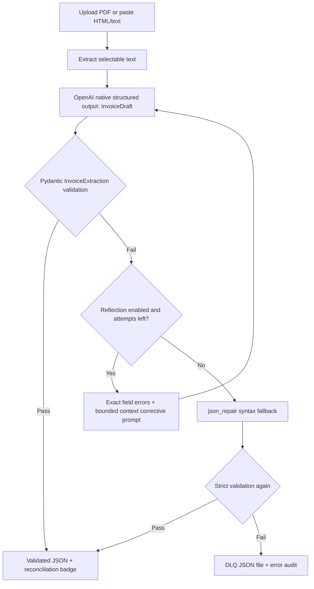

# Structured Data Extractor

A resilient commercial-invoice extraction demonstration for a college AI engineering assignment. It converts selectable-text PDFs or pasted HTML/text into Pydantic v2 validated invoice data, using OpenAI structured outputs, controlled reflection retries, JSON repair, and a local dead-letter queue.

## Architecture



## Schema specification

`LineItem`: `description: str` (required), `quantity: int` (>0), `unit_price: Decimal` (>0), `line_total: Decimal` (>=0); line total must match quantity × unit price within $0.02.

`InvoiceExtraction`: `invoice_number: str` (regex), `vendor_name: str`, `invoice_date: date` (ISO date or several standard forms), `line_items: list[LineItem]` (nonempty), `subtotal: Decimal` (>=0), `tax_amount: Decimal` (>=0), `total_amount: Decimal` (>=0), `currency: Literal["USD","EUR","GBP"]`. Sum of line totals must equal subtotal within 0.02; subtotal + tax must equal total within 0.02. Money uses `Decimal` for accurate accounting.

The native output schema (`InvoiceDraft`) intentionally accepts monetary/date strings before stricter deterministic conversion and reconciliation. Native JSON schema conformity alone does not guarantee that invoice arithmetic is correct.

## Requirements and setup (macOS / VS Code)

1. Install Python 3.11+, Git and [uv](https://docs.astral.sh/uv/). On macOS with Homebrew: `brew install uv`.
2. Extract the project ZIP and **open the `structured-data-extractor` folder in VS Code**.
3. In VS Code select **Terminal → New Terminal**. Run `pwd` and make sure the path ends in `structured-data-extractor`.
4. Run:

```bash
uv python install 3.11
uv sync
```

5. Copy the example environment file (do **not** put real keys into `.env.example`):

```bash
cp .env.example .env
```

6. Open `.env` in VS Code and replace `your_openai_key_here` with your real OpenAI API key. The `.env` file is ignored by Git; `.env.example` contains placeholders only.

## Run tests

```bash
uv run pytest -v
```

Tests mock provider responses and do not spend credits. The golden sample uses the real PDF text but a deterministic fake model response so that the schema test is repeatable.

## Run Streamlit

From the project root folder:

```bash
PYTHONPATH=. uv run streamlit run src/app.py
```

In macOS Terminal/VS Code Terminal, `PYTHONPATH=.` ensures that `src` imports resolve. Visit `http://localhost:8501` if the browser does not open automatically.

- Upload `samples/invoice_messy.pdf` or `samples/vendor_contract.html` and click **Extract and Validate**.
- The columns display source text alongside validated JSON; the reconciliation message and audit show success or error details.
- Turn on **Demo: inject first-attempt validation error** to force a known mismatch on the first attempt, then allow a real reflection retry. This requires a functioning API key and may not always recover; it is a transparent simulation.
- Click **Simulate Edge Case Failure (DLQ)** to process a deliberately irrecoverable mock response without API calls. It writes a JSON record into `dlq/`.
- Try `samples/invoice_invalid_total.html` to explore documents with genuinely inconsistent totals; reconciliation should not silently claim they are valid.
- Scanned/image-only PDFs are not OCR-supported by this minimal assignment implementation. Use selectable-text PDFs.

## Local Docker demo (optional alternative to cloud hosting)

Install Docker Desktop, then in this project directory:

```bash
docker compose up --build
```

Open `http://localhost:8501`. Stop with Ctrl+C; to remove containers later run `docker compose down`.

## Streamlit Community Cloud deployment

1. Push the repository to GitHub; verify `.env` has never been committed.
2. Visit https://share.streamlit.io/ and choose **Create app**.
3. Select `thuang2000/structured-data-extractor`, branch `main`, and **Main file path: `src/app.py`**.
4. Configure Streamlit app secrets in Cloud settings as TOML (`OPENAI_API_KEY = "..."` and `OPENAI_MODEL = "gpt-4o-mini"`). The application reads these secrets automatically.
5. Deploy, verify both a normal invoice and DLQ simulation, and confirm no keys appear in the repository. Cloud local `dlq/` storage is ephemeral and should not be relied on for durable human-review storage.

For Streamlit Community Cloud, the app supports secrets provided through `st.secrets`; configure in the app Settings → Secrets as TOML:

```toml
OPENAI_API_KEY = "YOUR_REAL_OPENAI_KEY"
OPENAI_MODEL = "gpt-4o-mini"
```

## Security

- `.env` is ignored by Git, `.env.example` is safe to commit only when it contains placeholders.
- The DLQ may contain document text, so do not upload a DLQ record containing private data to GitHub.
- Provider error messages are sanitized for the UI.

## AI audit summary

`ai_prompt_log.md` documents initial candidate flaws, corrections for penny reconciliation and retry token bloat, and strict fallback handling. The code has ten automated tests.

## Video walkthrough

See `VIDEO_SCRIPT.md` for the narrated 6-minute demonstration and screen instructions.
